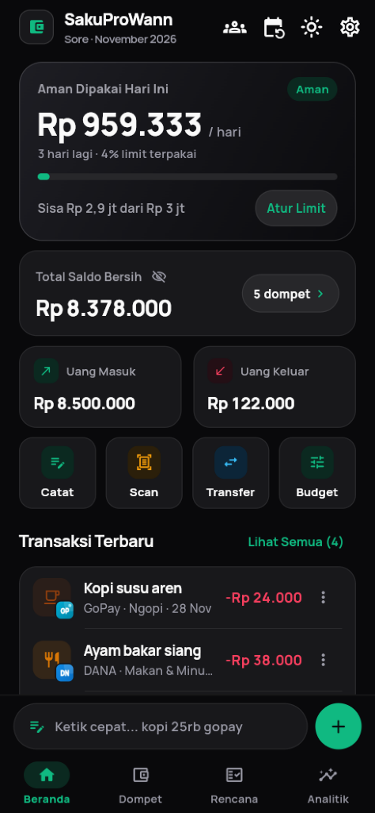
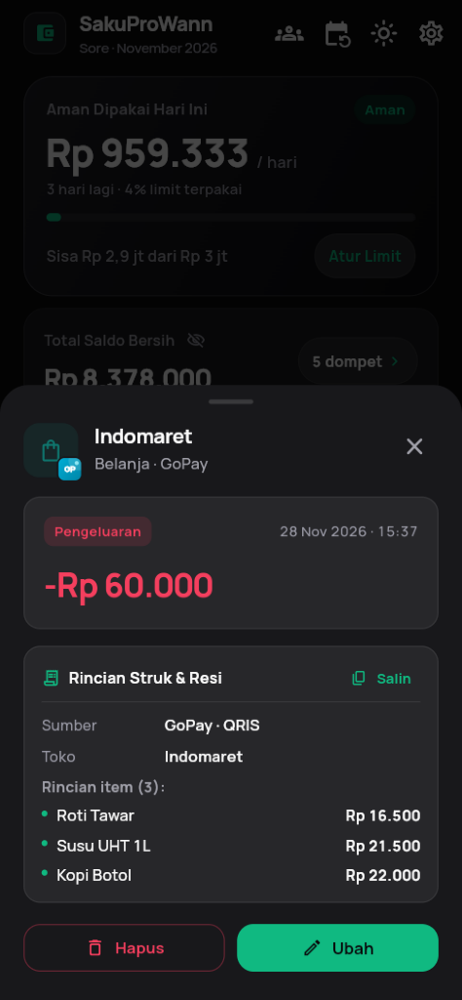
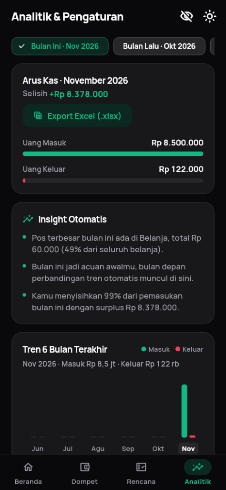
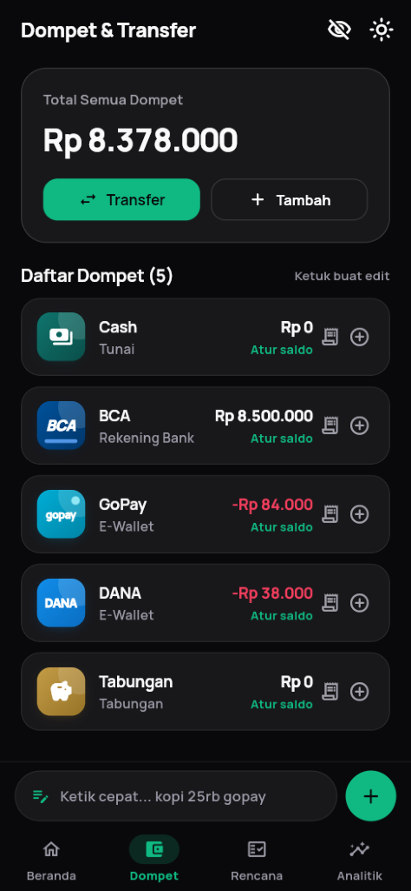

# SakuProWann

[](https://github.com/indrawanprasetyo5-bit/SakuPro/actions/workflows/ci.yml)
[](https://github.com/indrawanprasetyo5-bit/SakuPro/releases/latest)
[](https://indrawanprasetyo5-bit.github.io/SakuPro/)

Aplikasi Android pencatatan keuangan pribadi berbasis Flutter yang berjalan 100% offline-first dengan database SQLite lokal, tema Obsidian Dark dan Light Mode, serta integrasi Android native.

- **Coba Preview Interaktif di Browser**: [indrawanprasetyo5-bit.github.io/SakuPro](https://indrawanprasetyo5-bit.github.io/SakuPro/)
- **Unduh Installer APK Android**: [GitHub Releases](https://github.com/indrawanprasetyo5-bit/SakuPro/releases/latest)

## Tampilan Aplikasi

| Beranda & Safe-to-Spend | Rincian Struk & Resi | Analitik & Tren 6 Bulan | Multi-Dompet & Mutasi |
| :---: | :---: | :---: | :---: |
|  |  |  |  |

## Unduh APK Android

Pilih berkas APK dari [halaman rilis terbaru](https://github.com/indrawanprasetyo5-bit/SakuPro/releases/latest) sesuai arsitektur perangkat:

- `SakuProWann-v1.7.2-arm64.apk` (~32.5 MB): Direkomendasikan untuk hampir semua HP Android modern (64-bit).
- `SakuProWann-v1.7.2-armv7.apk` (~26.5 MB): Khusus HP Android lama (32-bit).

> Catatan: Versi Web Preview dijalankan dengan penyimpanan in-memory untuk eksplorasi tampilan dengan cepat (data ter-reset saat halaman di-refresh). Untuk pemakaian harian yang menyimpan data permanen di SQLite, kamera/galeri OCR, Share Intent, widget layar utama, dan biometrik, gunakan APK Android.

## Fitur Utama

- **Beranda Bento & Safe-to-Spend**: Menampilkan jatah belanja harian yang aman berdasarkan sisa anggaran dan sisa hari bulan berjalan, total saldo bersih, arus kas bulanan, serta riwayat terbaru dengan geser-untuk-hapus dan tombol `Urungkan`.
- **Ketik Cepat Ala Chat & Preset 1-Ketuk**: Catat langsung dari bar bawah (misalnya `kopi 25rb gopay`, `ayam bakar 38rb dana`, atau `gaji 8.5jt bca`) dengan 4 chip preset yang otomatis menyesuaikan kebiasaan 30 hari terakhir.
- **Scan Struk Multi-Baris & Share Resi Bank/E-Wallet (OCR Offline)**: Foto struk belanja atau kirim bukti transfer lewat tombol Bagikan (Share) dari Bank Jago, SeaBank, DANA, GoPay, OVO, ShopeePay, BCA/myBCA, Mandiri/Livin', BRImo, dan blu. Ekstraksi rincian item multi-baris, pajak/layanan (PB1/PPN/Service), diskon, catatan transfer, biaya admin, dompet asal, tanggal/jam resi, kategori pintar, arsip foto struk lokal, serta peringatan anti-catat ganda berjalan langsung di perangkat dengan Google ML Kit.
- **Split Bill / Patungan**: Hitung patungan bagi rata atau nominal per orang. Porsi pribadi langsung masuk ke pengeluaran, sedangkan porsi teman tercatat ke daftar Piutang dan siap ditagih lewat WhatsApp.
- **Riwayat Terfilter, Mutasi Dompet & Detail Struk**: Pencarian transaksi hingga ke nama barang di dalam struk, filter berdasarkan jenis, dompet, kategori, dan bulan, subtotal hasil filter, pengelompokan tanggal (`Hari Ini`, `Kemarin`), serta sheet rincian item lengkap dengan preview foto struk yang bisa diperbesar.
- **Analitik & Export Excel 5-Sheet**: Tren arus kas 6 bulan terakhir, pola pengeluaran mingguan, distribusi kategori yang dapat diketuk (drill-down) langsung ke daftar transaksi terkait, insight otomatis, dan export laporan `.xlsx` berformula (`Ringkasan Eksekutif`, `Buku Transaksi`, `Analisa Kategori & Budget`, `Dompet & Aset`, `Rencana & Kewajiban`).
- **Rencana Keuangan, Otomatisasi Lokal & Keamanan**: Budget per kategori, target tabungan (Goals + Auto-Save), tagihan rutin (Bills + Auto-Pay), Auto-Gaji, Hutang & Piutang, Backup/Restore JSON + pengelolaan ruang foto struk, kunci PIN 4 digit + Biometrik, AppWidget layar utama, dan Quick Settings Tile.

## Arsitektur & Tech Stack

- **Framework & Bahasa**: Flutter (Dart) + Kotlin (Android Native AppWidget, Quick Settings Tile, MediaStore Downloads & Local Reminders)
- **Database Lokal**: SQLite (`sqflite`) dengan migrasi skema aman
- **OCR, Keamanan & Export**: `google_mlkit_text_recognition`, `image_picker`, `local_auth`, `excel`, `share_plus`

Struktur kode utama:

```text
lib/
  db/        # Skema SQLite, migrasi, backup snapshot & fallback in-memory (Web preview)
  models/    # Model transaksi, dompet, kategori, anggaran, goals, tagihan, dan utang
  services/  # FinanceController, parser Quick-Add, OCR struk/resi, arsip foto, export XLSX/JSON
  screens/   # Layar Beranda, Dompet, Rencana, Analitik, PIN Lock, dan shell navigasi
  widgets/   # Bottom sheet input, rincian struk, riwayat terfilter, split bill, dan komponen tema
android/app/src/main/kotlin/
  id/sakupro/saku_pro/  # Share Intent handler, Home Widget, Quick Tile, & penyimpanan Downloads
test/        # Unit test, golden corpus OCR struk Indonesia, dan widget E2E test
```

## Menjalankan & Menguji di Lokal

```bash
flutter pub get
flutter analyze
flutter test
flutter run -d chrome
```

Untuk membangun APK rilis per arsitektur (`arm64-v8a` / `armeabi-v7a`):

```bash
flutter build apk --release --split-per-abi
```
